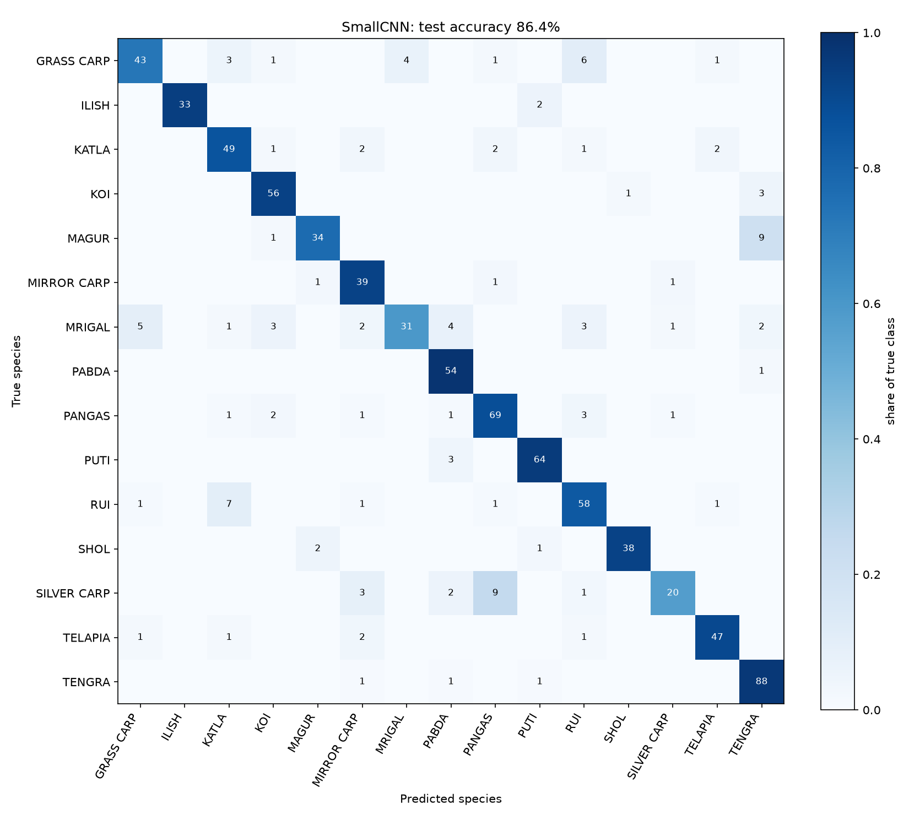
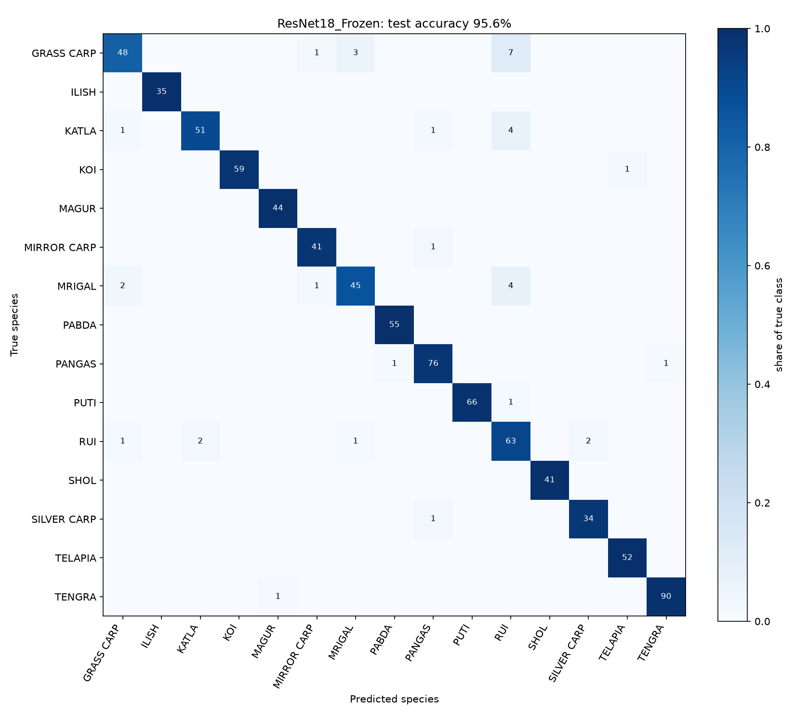
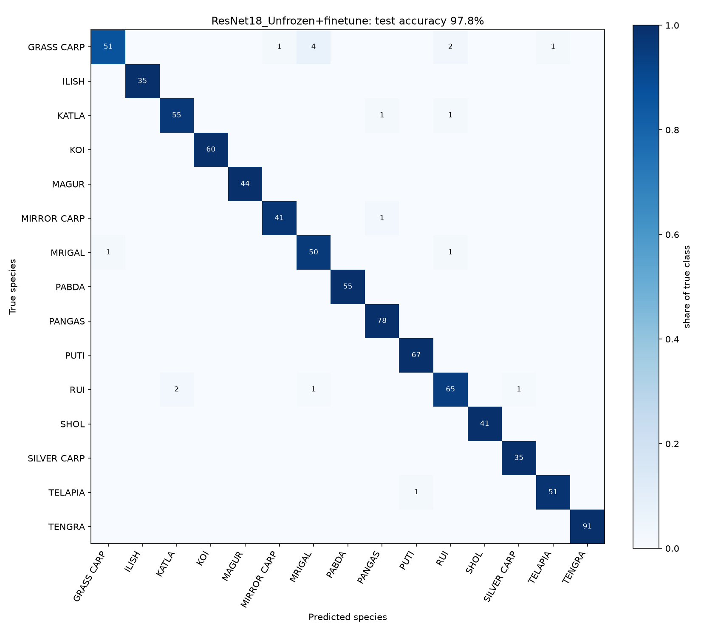

# Fish species classification: scratch CNN vs. pretrained ResNet18

15 fish species, 5,577 images (224×224), split 3,903 / 837 / 837 (train / val / test). Test set used once per model. One run per setting, MacBook Air GPU (MPS).

## Summary

- **Pretrained beats scratch** in every setting; fine-tuning the last block adds a little more.
- **Augmentation** (strong recipe) lowered accuracy for every model.
- **Less data** hurts the scratch CNN most.
- **Recommendation:** start with a frozen backbone, fine-tune the last block for 2–4 more points, train from scratch only with much more data, very different images, or a tiny-model requirement.
- **Caveat:** 9.4% of val/test images have an identical copy in the training set, so accuracies are probably optimistic.

## Models

| Model | Starting weights | Parameters trained | Training |
| --- | --- | --- | --- |
| 1. Scratch CNN | random | 243,471 (all) | 10 epochs, Adam 5e-4, cosine decay |
| 2. ResNet18, frozen backbone | ImageNet | 7,695 of 11,184,207 (new head) | 10 epochs, Adam 1e-3 |
| 3. ResNet18, fine-tuned | model 2 after training | 8,401,423 (`layer4` + head) | 5 more epochs, Adam 1e-5 (`layer4`), 1e-4 (head) |

## Main result (no augmentation, full training set)

| Model | Trainable params | Test acc. | Macro-F1 | Training time | Inference (ms/image) |
| --- | --- | --- | --- | --- | --- |
| Scratch CNN | 243,471 | 86.4% | 0.857 | 7.7 min | 1.40 |
| ResNet18, frozen backbone | 7,695 | 95.6% | 0.958 | 5.7 min | 1.88 |
| ResNet18, fine-tuned (`layer4`) | 8,401,423 | 98.0% | 0.980 | 8.8 min (5.7 head + 3.1 fine-tuning) | 1.88 |

## Experiment 1: data augmentation (full training set)

Augmentation: random resized crop (80–100%), horizontal and vertical flips, rotation up to 15°, color jitter (brightness, contrast, saturation 0.2, hue 0.1).

| Model | No augmentation (acc. / F1) | Augmentation (acc. / F1) | Change in accuracy |
| --- | --- | --- | --- |
| Scratch CNN | 86.4% / 0.857 | 64.6% / 0.585 | -21.8 points |
| ResNet18, frozen backbone | 95.6% / 0.958 | 91.4% / 0.915 | -4.2 points |
| ResNet18, fine-tuned (`layer4`) | 98.0% / 0.980 | 92.7% / 0.930 | -5.3 points |

## Experiment 2: training set size (no augmentation)

Training images: 25% ≈ 975, 50% ≈ 1,951, 100% = 3,903.

| Model | 25% (acc. / F1) | 50% (acc. / F1) | 100% (acc. / F1) | Change 100% → 25% |
| --- | --- | --- | --- | --- |
| Scratch CNN | 60.8% / 0.553 | 75.5% / 0.730 | 86.4% / 0.857 | -25.6 points |
| ResNet18, frozen backbone | 90.6% / 0.907 | 92.8% / 0.932 | 95.6% / 0.958 | -5.0 points |
| ResNet18, fine-tuned (`layer4`) | 94.6% / 0.949 | 96.3% / 0.964 | 98.0% / 0.980 | -3.4 points |

## All runs

| Setting | Model | Trainable params | Val acc. | Test acc. | Macro-F1 | Train time (s) | ms/image |
| --- | --- | --- | --- | --- | --- | --- | --- |
| No augmentation, 100% | Scratch CNN | 243,471 | 82.4% | 86.4% | 0.857 | 461 | 1.40 |
| No augmentation, 100% | ResNet18, frozen backbone | 7,695 | 94.4% | 95.6% | 0.958 | 340 | 1.88 |
| No augmentation, 100% | ResNet18, fine-tuned (`layer4`) | 8,401,423 | 96.9% | 98.0% | 0.980 | 528 | 1.88 |
| Augmentation, 100% | Scratch CNN | 243,471 | 63.8% | 64.6% | 0.585 | 460 | 1.40 |
| Augmentation, 100% | ResNet18, frozen backbone | 7,695 | 91.2% | 91.4% | 0.915 | 343 | 1.87 |
| Augmentation, 100% | ResNet18, fine-tuned (`layer4`) | 8,401,423 | 93.4% | 92.7% | 0.930 | 532 | 1.89 |
| No augmentation, 50% | Scratch CNN | 243,471 | 71.3% | 75.5% | 0.730 | 364 | 1.39 |
| No augmentation, 50% | ResNet18, frozen backbone | 7,695 | 92.5% | 92.8% | 0.932 | 305 | 1.87 |
| No augmentation, 50% | ResNet18, fine-tuned (`layer4`) | 8,401,423 | 95.7% | 96.3% | 0.964 | 466 | 1.87 |
| No augmentation, 25% | Scratch CNN | 243,471 | 59.5% | 60.8% | 0.553 | 315 | 1.39 |
| No augmentation, 25% | ResNet18, frozen backbone | 7,695 | 89.7% | 90.6% | 0.907 | 288 | 1.87 |
| No augmentation, 25% | ResNet18, fine-tuned (`layer4`) | 8,401,423 | 93.3% | 94.6% | 0.949 | 436 | 1.87 |

## Confusion matrix

Retrained with the same recipe (no augmentation, full training set); images: `confusion_<model>.png`. The fine-tuned model scored 97.8% here against 98.0% in the main run, because GPU runs are not exactly repeatable. For the fine-tuned model, four of the five most common confusions are between carp species (Grass carp, Mrigal, Rui, Katla, Silver carp).

**Scratch CNN**: test acc. 86.4%, macro-F1 0.857. Most common confusions (count, true → predicted):
- 9× SILVER CARP → PANGAS
- 9× MAGUR → TENGRA
- 7× RUI → KATLA
- 6× GRASS CARP → RUI
- 5× MRIGAL → GRASS CARP


**ResNet18, frozen backbone**: test acc. 95.6%, macro-F1 0.958. Most common confusions (count, true → predicted):
- 7× GRASS CARP → RUI
- 4× MRIGAL → RUI
- 4× KATLA → RUI
- 3× GRASS CARP → MRIGAL
- 2× RUI → SILVER CARP


**ResNet18, fine-tuned (`layer4`)**: test acc. 97.8%, macro-F1 0.979. Most common confusions (count, true → predicted):
- 4× GRASS CARP → MRIGAL
- 2× RUI → KATLA
- 2× GRASS CARP → RUI
- 1× TELAPIA → PUTI
- 1× RUI → SILVER CARP


## Run

Put the dataset folder `BD-FISH15-CLEAN-DATASET` [dataset link](https://zenodo.org/records/18881332?preview_file=BD-FISH15-CLEAN-DATASET.zip) in the project root (it is not in git).

```bash
python run_experiment.py noaug_100 aug_100 noaug_50 noaug_25   # results_<name>.json
python confusion.py                                            # confusion matrices
```
